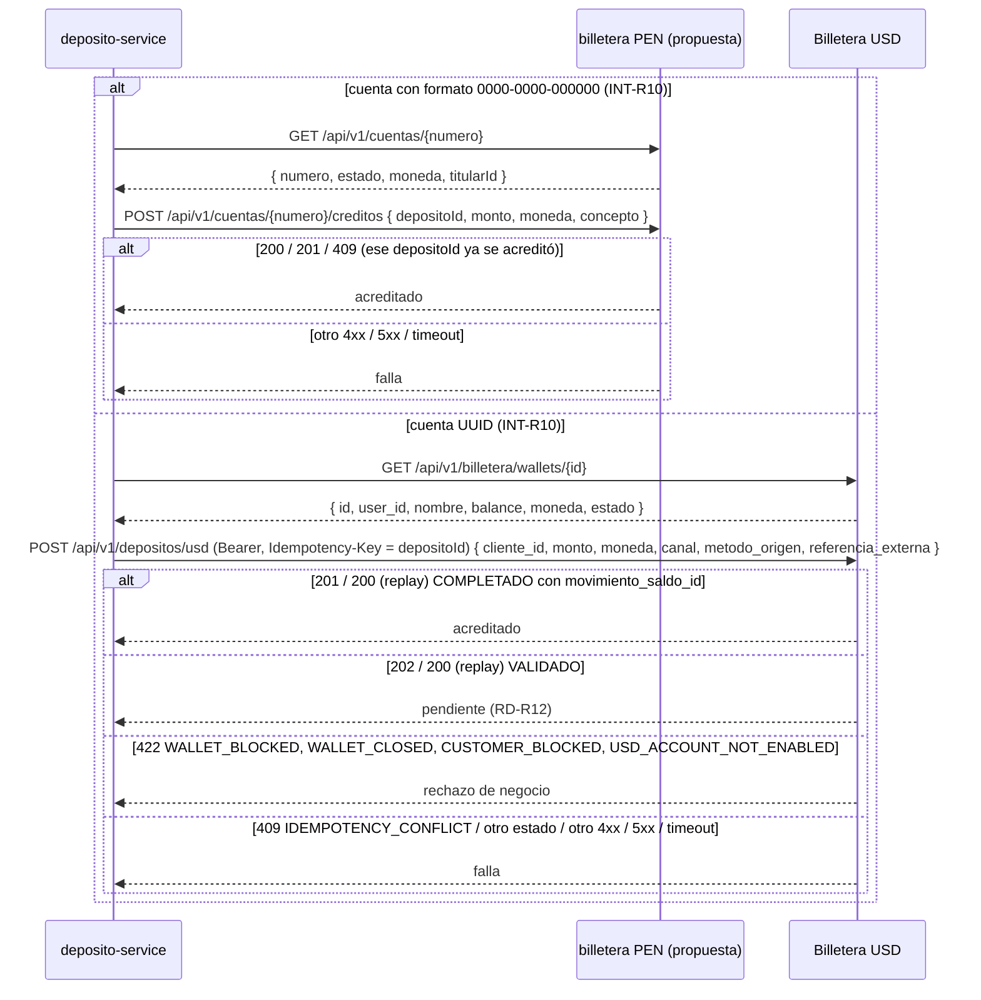

# SPEC-02 · Integraciones: billeteras (PEN y USD) y usuario-service

> **PROPUESTA, no vigente.** Vigente: `specs-v2/02-integraciones.md`. Motivo y decisiones: `docs/propuesta-billetera-usd-v1.2.md`.

## 1. Metadatos y Tech Stack

**Objetivo:** Definir cómo deposito-service se integra con las billeteras y con usuario-service: el cliente HTTP, los mocks y los datos de prueba. Las cuentas en dólares viven en **Billetera Digital USD** (contrato `docs/referencia/Billetera_USD_openapi_v1.2.0.yaml`); las cuentas en soles viven en una **billetera PEN** que aún no existe y cuyo contrato es la PROPUESTA de deposito-service.

- **Estado:** Billetera USD: contrato publicado v1.2.0, implementado en parte (OAuth aún no se aplica). `POST /depositos/usd` abona la billetera (Q13, pendiente de implementar en Billetera USD); sin `cuenta_destino_id` (Q14). [POR ACORDAR]: URL de tokens (Q9). Billetera PEN y usuario-service: [POR ACORDAR].
- **Depende de:** SPEC-00, SPEC-01 (`ErrorApp`).
- **Lo usan:** SPEC-03 (JWT), SPEC-07 (consultar y acreditar), SPEC-08 y SPEC-09 (titular de la cuenta).
- **Versión spec:** 2.1 (propuesta)

**Stack:** axios 1.7.9 (cliente), Express 4.21 (mock), jsonwebtoken 9.0.2. Pruebas: nock 13.5.

## 2. Archivos Involucrados

El Agente tiene permitido leer y modificar ÚNICAMENTE los siguientes archivos:

- [NUEVO] `src/core/clients/billeteraClient.js` (Único lugar que conoce `BILLETERA_URL` y `BILLETERA_USD_URL`. Exporta `consultarCuenta(numero, correlationId)` y `acreditar(datos, correlationId)`; enruta a la billetera PEN o USD según INT-R10).
- [NUEVO] `mocks/billetera/server.js` · `mocks/billetera/Dockerfile` (Mock en memoria, puerto 4000, que atiende las rutas de ambas billeteras de §5. Referencia para las rutas USD: `docs/specs-propuestas/mock-billetera-usd/server.js`).
- [NUEVO] `tests/helpers/billetera.js` (Helpers de nock. PEN: `cuentaActiva`, `cuentaNoExiste`, `consultaFalla`, `acreditaOk`, `acreditaFalla`, `acreditaLento`, `acreditaYaExiste`. USD: `billeteraUsdExiste`, `billeteraUsdBloqueada`, `billeteraUsdCerrada`, `billeteraUsdNoExiste`, `consultaUsdFalla`, `acreditaUsdOk`, `acreditaUsdReplay`, `acreditaUsdConflicto`, `acreditaUsdPendiente`, `acreditaUsdRechazo`, `acreditaUsdFalla`, `acreditaUsdLento`, `tokenUsdOk`, `tokenUsdFalla`).
- [NUEVO] `tests/helpers/tokens.js` (`token(usuario, { exp, aud, clave, alg })` con el par RSA de `tests/.tmp/`).
- [NUEVO] `scripts/generar-claves-dev.js` (Par RSA de desarrollo en `.dev-keys/`).
- [NUEVO] `scripts/generar-token.js` (`node scripts/generar-token.js usr-agente-1`).
- [NUEVO] `tests/unit/integraciones/billeteraClient.test.js`

## 3. Flujo del Sistema



## 4. Reglas de Negocio

- **INT-R01** · Solo HTTP. Nunca acceso a la base de datos de otro servicio.
- **INT-R02** · Toda llamada envía `X-Correlation-Id`. A la billetera PEN se envía `Authorization: Bearer <BILLETERA_TOKEN>`; a Billetera USD, el token OAuth de INT-R13.
- **INT-R03** · Timeout `BILLETERA_TIMEOUT_MS` en todas las llamadas, a ambas billeteras.
- **INT-R10** · Enrutamiento por formato de la cuenta: `^\d{4}-\d{4}-\d{6}$` → billetera PEN (`BILLETERA_URL`, reglas INT-R11 e INT-R12); UUID → Billetera USD (`BILLETERA_USD_URL`, reglas INT-R04 e INT-R05). El enrutamiento vive solo en `billeteraClient.js`; quien llama no sabe a qué billetera va.

**Billetera USD**

- **INT-R04** · `consultarCuenta(id)` → `GET /api/v1/billetera/wallets/{id}` (`id` = UUID de la billetera). 200 → devuelve `{ numero: id, estado, moneda: wallet.moneda, titularId: wallet.user_id }`, con `estado`: `ACTIVE → ACTIVA`, `BLOCKED → BLOQUEADA`, `CLOSED → CERRADA`. `estado` ausente o desconocido, o `user_id` ausente → lanza `ErrorApp('BILLETERA_NO_DISPONIBLE')`; `estado` ausente se acepta como `ACTIVA` solo durante la transición (Q7). 404 → devuelve `null`; otro status o timeout → lanza `ErrorApp('BILLETERA_NO_DISPONIBLE')`. `balance` y `nombre` se ignoran: no se guardan ni se loguean (PRY-R10).
- **INT-R05** · `acreditar({ depositoId, cuenta, monto, moneda, titularId, canal }, correlationId)` → `POST /api/v1/depositos/usd` con cabecera `Idempotency-Key: <depositoId>`. Resuelve con `{ estado: 'ACREDITADO' }` o `{ estado: 'PENDIENTE' }`:
  - 201 o 200 (replay) con `estado: "COMPLETADO"` y `movimiento_saldo_id` no nulo → `ACREDITADO`.
  - 202 o 200 (replay) con `estado: "VALIDADO"` o `"PENDIENTE"` → `PENDIENTE`.
  - 200 (replay) con `estado: "FALLIDO"` → lanza `ErrorApp('BILLETERA_NO_DISPONIBLE')`.
  - 422 `WALLET_BLOCKED`, `WALLET_CLOSED`, `CUSTOMER_BLOCKED` o `USD_ACCOUNT_NOT_ENABLED` → lanza `ErrorApp('CUENTA_INACTIVA')` (D3).
  - 409 (`IDEMPOTENCY_CONFLICT`: misma clave con datos distintos) → lanza `ErrorApp('BILLETERA_NO_DISPONIBLE')` y se loguea como `error`.
  - 401 o 403 → lanza `ErrorApp('BILLETERA_NO_DISPONIBLE')` y se loguea como `error` (fallo de configuración).
  - Cualquier otra respuesta o estado, 429, 5xx o timeout → lanza `ErrorApp('BILLETERA_NO_DISPONIBLE')`.
- **INT-R06** · Sin reintentos automáticos dentro de `acreditar` (ambas billeteras); la reconciliación (RD-R13) es un proceso aparte que reenvía la misma petición. En Billetera USD la protección contra doble acreditación es la `Idempotency-Key` = `depositoId` (UUID v4); un reintento manual (RD-R08) o una reconciliación reenvía la misma clave con un body idéntico, armado con los datos guardados del depósito, y billetera responde 200 (replay). En la billetera PEN la protección es el `depositoId` del body (INT-R12).
- **INT-R07** · Body: `cliente_id` = `titularId` (`user_id` de la billetera: el cliente que **recibe** el depósito, no quien lo registra); sin `cuenta_destino_id`: la cuenta en dólares es la billetera USD del cliente y Billetera USD usa la que corresponde a `cliente_id` (Q14); `monto` string con 2 decimales; `moneda` = `"USD"`; `canal` = canal del depósito; `metodo_origen` según canal (`x-channel-method-policy`): `VENTANILLA → EFECTIVO`, `AGENTE → EFECTIVO`, `APP → TRANSFERENCIA`; `referencia_externa` = `depositoId`.
- **INT-R13** · OAuth 2.0 client credentials contra `BILLETERA_USD_TOKEN_URL`, con scopes `billetera/wallets.read`, `billetera/depositos.write`. El token se guarda en memoria y se reutiliza hasta 60 s antes de expirar; no se pide uno por operación, y las peticiones simultáneas comparten la misma solicitud. No obtener token → `BILLETERA_NO_DISPONIBLE`. El secreto y el token nunca se loguean (PRY-R10). Sin `BILLETERA_USD_TOKEN_URL` no se envía `Authorization` (transición, Q7).
- **INT-R14** · `POST /api/v1/depositos/usd` abona `Wallet.balance` (Q13). `COMPLETADO` significa que Billetera USD confirmó el depósito con `movimiento_saldo_id` y abonó la billetera. No se usa `POST /wallets/{id}/depositos`, que no es idempotente.

**Billetera PEN (propuesta)**

- **INT-R11** · `consultarCuenta(numero)` → `GET /api/v1/cuentas/{numero}`: 200 → devuelve `{ numero, estado, moneda, titularId }`; 404 → devuelve `null`; otro status o timeout → lanza `ErrorApp('BILLETERA_NO_DISPONIBLE')`.
- **INT-R12** · `acreditar({ depositoId, cuenta, monto, moneda })` → `POST /api/v1/cuentas/{numero}/creditos` con body `{ depositoId, monto, moneda, concepto: "DEPOSITO" }` (`monto` string con 2 decimales): 200, 201 o 409 (ese `depositoId` ya se acreditó) → resuelve con `{ estado: 'ACREDITADO' }`; otro status o timeout → lanza `ErrorApp('BILLETERA_NO_DISPONIBLE')`.

**Común**

- **INT-R08** · El JWT se valida localmente (SPEC-03). Nunca se llama a usuario-service por petición.

**Datos de prueba compartidos** (los usan el mock y los helpers; ninguna prueba inventa otros):

- **Cuentas PEN (billetera PEN):** `0011-0123-456789` ACTIVA PEN, titular `usr-cliente-1` · `0011-0123-000002` ACTIVA PEN, titular `usr-cliente-2` · `0011-0123-000003` BLOQUEADA PEN, titular `usr-cliente-1`.
- **Cuentas PEN especiales del mock:** `0011-0123-999999` ACTIVA PEN, responde 500 al acreditar · `0011-0123-888888` ACTIVA PEN, tarda 6 s al acreditar.
- **Billeteras USD (Billetera USD):** `11111111-1111-4111-8111-111111111111` USD ACTIVE, titular `usr-cliente-1` · `22222222-2222-4222-8222-222222222222` USD ACTIVE, titular `usr-cliente-2` · `33333333-3333-4333-8333-333333333333` USD BLOCKED, titular `usr-bloqueada` · `44444444-4444-4444-8444-444444444444` USD CLOSED, titular `usr-cerrada`.
- **Billeteras USD especiales del mock** (ACTIVE; como el body no lleva la billetera, el comportamiento depende de `cliente_id`): `99999999-9999-4999-8999-999999999999` / `usr-falla` responde 503 al acreditar · `88888888-8888-4888-8888-888888888888` / `usr-lento` registra el depósito y tarda 6 s en responder · `55555555-5555-4555-8555-555555555555` / `usr-carrera` 422 `WALLET_BLOCKED` · `66666666-6666-4666-8666-666666666666` / `usr-cliente-bloqueado` 422 `CUSTOMER_BLOCKED` · `77777777-7777-4777-8777-777777777777` / `usr-sin-usd` 422 `USD_ACCOUNT_NOT_ENABLED` · `aaaaaaaa-aaaa-4aaa-8aaa-aaaaaaaaaaaa` / `usr-pendiente` 202 y luego `COMPLETADO` · `bbbbbbbb-bbbb-4bbb-8bbb-bbbbbbbbbbbb` / `usr-pendiente-falla` 202 y luego `FALLIDO` · `cccccccc-cccc-4ccc-8ccc-cccccccccccc` / `usr-falla-una-vez` 503 la primera vez y luego OK.
- **Usuarios:** `usr-cliente-1` y `usr-cliente-2` (CLIENTE) · `usr-agente-1` y `usr-agente-2` (AGENTE) · `usr-cajero-1` (CAJERO).
- **INT-R09** · Mock. Rutas PEN: guarda en memoria los `depositoId` acreditados y responde 409 si se repiten. Rutas USD: valida el body según el contrato (campos obligatorios, sin campos extra, política de canal y método); guarda en memoria cada `Idempotency-Key` con su body; misma clave y mismo body → 200 (replay); misma clave y otro body → 409 `IDEMPOTENCY_CONFLICT`; si no, 201 con `estado: "COMPLETADO"` y `movimiento_saldo_id`, salvo los casos especiales de arriba. No cambia `balance` (INT-R14).

## 5. El Contrato (API Contract)

**Billetera USD · Consultar billetera:** `GET /api/v1/billetera/wallets/{id}` → **HTTP 200**
```json
{ "id": "3fa85f64-5717-4562-b3fc-2c963f66afa6", "user_id": "usr-cliente-1", "nombre": "Cliente Uno", "balance": "350.75", "moneda": "USD", "estado": "ACTIVE" }
```
**HTTP 404** si la billetera no existe.

**Billetera USD · Acreditar:** `POST /api/v1/depositos/usd` · cabecera `Idempotency-Key: 7f1c2e9a-0b1d-4c5e-9f00-123456789abc`
```json
{ "cliente_id": "usr-cliente-1", "monto": "150.00", "moneda": "USD", "canal": "AGENTE", "metodo_origen": "EFECTIVO", "referencia_externa": "7f1c2e9a-0b1d-4c5e-9f00-123456789abc" }
```
**HTTP 201** con `estado: "COMPLETADO"` y `movimiento_saldo_id` · **HTTP 202** con `estado: "VALIDADO"`, `Location` y `Retry-After` · **HTTP 200** replay de la misma clave · **HTTP 409** `IDEMPOTENCY_CONFLICT` si la clave se usó con otro body (es un error) · **HTTP 422** rechazos de negocio de INT-R05.

**Billetera PEN (propuesta) · Consultar cuenta:** `GET /api/v1/cuentas/{numero}` → **HTTP 200**
```json
{ "numero": "0011-0123-456789", "estado": "ACTIVA", "moneda": "PEN", "titularId": "usr-cliente-1" }
```
**HTTP 404** si la cuenta no existe.

**Billetera PEN (propuesta) · Acreditar:** `POST /api/v1/cuentas/{numero}/creditos`
```json
{ "depositoId": "7f1c2e9a-0b1d-4c5e-9f00-123456789abc", "monto": "150.00", "moneda": "PEN", "concepto": "DEPOSITO" }
```
**HTTP 201** si acreditó · **HTTP 409** si ese `depositoId` ya fue acreditado.

**usuario · Payload propuesto del JWT** (firma RS256 [POR ACORDAR])
```json
{ "sub": "usr-cliente-1", "roles": ["CLIENTE"], "iss": "usuario-service", "aud": "banco-api", "exp": 1760000000 }
```

- `sub` → `usuario_id` en depósitos, idempotencia y auditoría; en Billetera USD, `sub` del titular = `user_id` de la billetera (verificación de titular, Q4). `cliente_id` = `user_id` de la billetera, sale de la consulta y no del JWT.
- `roles` → CLIENTE, AGENTE o CAJERO (SPEC-03).
- `iss`, `aud`, `exp` → validación del token.

## 6. Instrucciones de Ejecución para el Agente

1. **`desarrolladorback`:** Crear los archivos de §2. El mock es para probar a mano con `docker compose`; las pruebas automáticas usan nock.
2. **`tester`:**
   - Billetera PEN:
   - **INT-T01** · Consultar con 200 → devuelve la cuenta.
   - **INT-T02** · Consultar con 404 → devuelve `null`.
   - **INT-T03** · Consultar con 500 y con timeout → `BILLETERA_NO_DISPONIBLE`.
   - **INT-T04** · Acreditar con 201 y con 409 → resuelve.
   - **INT-T05** · Acreditar con 400, 500 y timeout → `BILLETERA_NO_DISPONIBLE`; nock recibió 1 sola llamada.
   - **INT-T06** · Cualquier llamada → lleva `Authorization` y `X-Correlation-Id`.
   - **INT-T07** · `acreditar` con monto `Decimal(150)` → el body lleva `"150.00"`.
   - Billetera USD:
   - **INT-T08** · Consultar con 200 → `{ numero: id, estado: "ACTIVA", moneda: "USD", titularId: user_id }`, sin `balance` ni `nombre`; `BLOCKED` → `BLOQUEADA`; `CLOSED` → `CERRADA`; `estado` desconocido → `BILLETERA_NO_DISPONIBLE`.
   - **INT-T09** · Consultar con 404 → `null`; con 500 y con timeout → `BILLETERA_NO_DISPONIBLE`.
   - **INT-T10** · Acreditar con 201 `COMPLETADO` y con 200 (replay) `COMPLETADO` → resuelve `ACREDITADO`; la petición lleva `Idempotency-Key` = `depositoId`; `COMPLETADO` sin `movimiento_saldo_id` → `BILLETERA_NO_DISPONIBLE`.
   - **INT-T11** · Acreditar con 409 → `BILLETERA_NO_DISPONIBLE` y log `error`; con 202 `VALIDADO` y con 200 `VALIDADO` → resuelve `PENDIENTE`; con 200 `FALLIDO` → `BILLETERA_NO_DISPONIBLE`.
   - **INT-T12** · Acreditar con 400, 500 y timeout → `BILLETERA_NO_DISPONIBLE`; nock recibió 1 sola llamada.
   - **INT-T13** · Body exacto: monto `Decimal(150)` → `"150.00"`, `moneda: "USD"`, `cliente_id` = `titularId`, `canal`, `referencia_externa` = `depositoId`, sin `concepto` ni `cuenta_destino_id`; `metodo_origen` correcto para los 3 canales.
   - Enrutamiento y cabeceras:
   - **INT-T14** · INT-R10: cuenta `0011-0123-456789` → solo se llama a la billetera PEN; UUID → solo a Billetera USD.
   - **INT-T15** · Billetera USD sin `BILLETERA_USD_TOKEN_URL` → sin `Authorization`; con ella → lleva el token OAuth; `X-Correlation-Id` siempre.
   - **INT-T16** · Dos llamadas seguidas → 1 sola petición de token; a menos de 60 s de expirar → pide uno nuevo.
   - **INT-T17** · Fallo al obtener el token → `BILLETERA_NO_DISPONIBLE`; el secreto y el token no aparecen en los logs.
   - **INT-T18** · Acreditar con 422 `WALLET_BLOCKED`, `WALLET_CLOSED`, `CUSTOMER_BLOCKED` y `USD_ACCOUNT_NOT_ENABLED` → `CUENTA_INACTIVA`.
   - **INT-T19** · Acreditar con 401 y 403 → `BILLETERA_NO_DISPONIBLE` y log `error`.
3. **`revisor`:** Verificar INT-R06, INT-R10 y que ninguna URL de billetera aparece fuera de `billeteraClient.js` y `.env.example`.

**Criterios de aceptación:**
- ✅ El servicio funciona de punta a punta con el mock mientras los otros equipos confirman.
- ✅ Cambiar a cada billetera real solo requiere cambiar su configuración: `BILLETERA_URL` / `BILLETERA_TOKEN` (PEN) y `BILLETERA_USD_URL` / `BILLETERA_USD_TOKEN_URL` / `BILLETERA_USD_CLIENT_ID` / `BILLETERA_USD_CLIENT_SECRET` (USD).
- ✅ Un depósito a una billetera USD nunca se acredita dos veces aunque se reintente.
