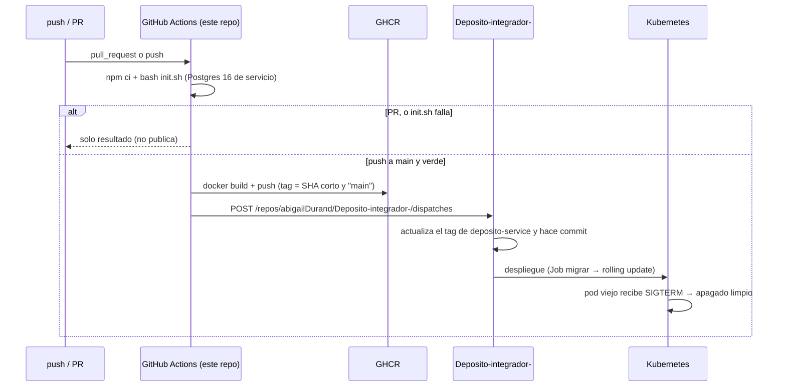

# SPEC-13 · ci-cd

> **PROPUESTA, no vigente.** Para que sea vigente, el humano la copia a `specs-v2/13-ci-cd.md` sin este aviso,
> regenera el hash (`node .harness/specs.js generar`) y el leader añade la feature 13 a `feature_list.json`.

## 1. Metadatos y Tech Stack

**Objetivo:** Que cada cambio en `main` se verifique, se publique como imagen en GitHub Container Registry (GHCR) y
avise al repo integrador, que es quien despliega en Kubernetes. Este repo no despliega ni tiene credenciales de la
nube. Incluye lo que el servicio necesita para vivir en un clúster: apagado limpio con `SIGTERM` y migraciones de
esquema que funcionan sobre una base existente.

- **Id:** `ci-cd` · **Tipo:** infraestructura (no es una extensión del pipeline).
- **Depende de:** SPEC-00 (config, Docker), SPEC-05 (`limpiarClaves`), SPEC-06 (`server.js`), SPEC-07 (`reconciliacion`).
- **Otros repos:** orquestador `abigailDurand/Deposito-integrador-` (manifiestos de Kubernetes; recibe el aviso).
- **Versión spec:** 1.0

**Stack:** GitHub Actions; `docker/login-action` y `docker/build-push-action` contra `ghcr.io`; PostgreSQL 16 como
servicio del job; `pg` 8.13. Pruebas: Jest 29.

## 2. Archivos Involucrados

El Agente tiene permitido leer y modificar ÚNICAMENTE los siguientes archivos:

- [NUEVO] `.github/workflows/ci.yml` (Verificar en cada PR y push; en push a `main`, publicar en GHCR y avisar al integrador).
- [NUEVO] `scripts/migrar.js` (`npm run migrar`: aplica `db/*.sql` en orden, idempotente, con bloqueo).
- [MODIFICAR] `db/*.sql` (Volverlos idempotentes, CI-R08; sin cambiar el esquema resultante).
- [MODIFICAR] `src/server.js` (Apagado limpio, CI-R10..R12).
- [MODIFICAR] `src/modules/registrar-deposito/reconciliacion.js` (Hoy `detener()` solo hace `clearInterval`: debe devolver una promesa que espere el ciclo en curso).
- [MODIFICAR] `src/core/tareas/limpiarClaves.js` (Hoy solo exporta `iniciar()`: añadir `detener()`, que espera la limpieza en curso).
- [MODIFICAR] `src/config.js` · `.env.example` (`APAGADO_TIMEOUT_MS`).
- [MODIFICAR] `package.json` (Script `migrar`) · `Dockerfile` (Incluir `scripts/` y `db/` en la imagen).
- [NUEVO] `tests/integration/ci-cd/migrar.test.js` · `tests/unit/ci-cd/apagado.test.js`

## 3. Flujo del Sistema



## 4. Reglas de Negocio

**CI/CD**
- **CI-R01** · `ci.yml` corre en `pull_request` (cualquier rama) y en `push` a `main`. Un job `verificar` levanta PostgreSQL 16 como servicio, hace `npm ci` y `bash init.sh` completo con las variables de `.env.example` necesarias para pruebas. Si falla, el workflow falla y no se publica nada.
- **CI-R02** · Solo en `push` a `main` y con `verificar` en verde, el job `publicar` construye la imagen con el `Dockerfile` del repo y la sube a `ghcr.io/abigaildurand/deposito-service` (en minúsculas, como exige GHCR) con dos tags: el SHA corto del commit (inmutable, el que se despliega) y `main`. Añade la etiqueta OCI `org.opencontainers.image.source` con la URL de este repo.
- **CI-R03** · GHCR se autentica con el `GITHUB_TOKEN` del propio workflow; no hay credenciales de la nube ni variables de AWS en este repo. Permisos del workflow: `contents: read` y, solo en `publicar`, `packages: write`. El acceso del clúster a la imagen (paquete público o `imagePullSecret`) lo resuelve el integrador.
- **CI-R04** · Tras publicar, el job `avisar` llama a `POST /repos/abigailDurand/Deposito-integrador-/dispatches` con `event_type: "servicio-actualizado"` y `client_payload: { servicio: "deposito-service", imagen: "<registry>/<repo>", tag: "<sha corto>", commit: "<sha completo>" }`. Usa el secreto `ORQUESTADOR_TOKEN` (fine-grained PAT o GitHub App, solo con acceso a ese repo). Si el secreto no está configurado, el paso se omite con un aviso y el workflow no falla.
- **CI-R05** · Ningún secreto ni URL real se escribe en el repo (PRY-R09). El workflow no imprime tokens. `ORQUESTADOR_TOKEN` no tiene permisos sobre otros repos.
- **CI-R06** · Dos ejecuciones de `verificar` nunca comparten base de datos (cada job tiene su propio servicio Postgres). En `main`, `concurrency` cancela publicaciones anteriores aún en curso.

**Migraciones**
- **CI-R07** · `npm run migrar` aplica todos los `db/*.sql` en orden alfabético contra `DATABASE_URL`, dentro de una transacción y con `pg_advisory_xact_lock` para que dos réplicas o Jobs simultáneos no migren a la vez. Termina con código 0 si todo se aplicó y ≠ 0 si algo falla (rollback completo).
- **CI-R08** · Los `db/*.sql` son idempotentes: `CREATE TABLE IF NOT EXISTS`, `CREATE INDEX IF NOT EXISTS`, `CREATE OR REPLACE FUNCTION`, `DROP TRIGGER IF EXISTS` antes de `CREATE TRIGGER`, `INSERT ... ON CONFLICT DO NOTHING` para los datos de ejemplo, y toda columna añadida después de la creación inicial se garantiza además con `ALTER TABLE ... ADD COLUMN IF NOT EXISTS` (p. ej. `depositos.titular_id`, DOM-R11). Aplicarlos dos veces deja el mismo esquema y los mismos datos.
- **CI-R09** · Las pruebas (`globalSetup`) y el arranque de Postgres en docker compose siguen aplicando los mismos archivos; no hay un segundo juego de SQL.

**Apagado limpio**
- **CI-R10** · Al recibir `SIGTERM` o `SIGINT`, `server.js`: deja de aceptar conexiones (`server.close`), llama a `detener()` de la reconciliación y de `limpiarClaves`, espera a que terminen las peticiones en curso y el ciclo de reconciliación en curso, cierra el pool de PostgreSQL y sale con código 0. Lo registra con `logger.info`.
- **CI-R11** · Si no terminó en `APAGADO_TIMEOUT_MS` (def. `10000`, menor que el `terminationGracePeriodSeconds` de 30 s de Kubernetes), registra `logger.error` y sale con código 1.
- **CI-R12** · Una segunda señal durante el apagado no inicia otro apagado. `detener()` sin `iniciar()` previo no falla.

## 5. El Contrato (API Contract)

**`repository_dispatch` hacia el orquestador** (lo consume `Deposito-integrador-`):
```json
{
  "event_type": "servicio-actualizado",
  "client_payload": {
    "servicio": "deposito-service",
    "imagen": "ghcr.io/abigaildurand/deposito-service",
    "tag": "d132425",
    "commit": "d132425<sha completo>"
  }
}
```

**Kubernetes (lo implementa el orquestador; referencia):** Job o initContainer con `command: ["node", "scripts/migrar.js"]` antes de cada despliegue; `terminationGracePeriodSeconds: 30`; probe en `GET /health`. La imagen debe incluir `scripts/` y `db/` (CI-R07), por eso §2 modifica el `Dockerfile`.

## 6. Instrucciones de Ejecución para el Agente

1. **`desarrolladorback`:** archivos de §2. `migrar.js` reutiliza la conexión de `src/core/db` o `pg` con `DATABASE_URL`, sin duplicar configuración. No cambia el esquema resultante.
2. **`tester`:**
   - **CI-T01** · `migrar` sobre una base vacía → esquema completo; ejecutarlo otra vez → 0 cambios y sin error.
   - **CI-T02** · `migrar` sobre una base con el esquema anterior a SPEC-01 v1.2 (sin `titular_id`) → la columna existe y las filas se conservan.
   - **CI-T03** · Dos `migrar` simultáneos → ambos terminan bien y el esquema queda una sola vez (advisory lock).
   - **CI-T04** · Un `.sql` con error → código ≠ 0 y nada aplicado (rollback).
   - **CI-T05** · `SIGTERM` con una petición en curso → la petición responde, luego `pool.end()` y salida 0; no se aceptan conexiones nuevas.
   - **CI-T06** · `SIGTERM` con un ciclo de reconciliación en curso → espera a que termine antes de cerrar el pool.
   - **CI-T07** · Apagado que no termina en `APAGADO_TIMEOUT_MS` → `logger.error` y salida 1; una segunda señal no duplica el apagado.
3. **`revisor`:** verificar CI-R03 y CI-R05 (sin credenciales de la nube ni secretos en el repo, permisos mínimos por job), CI-R08 en cada `db/*.sql`, y que `ci.yml` pasa `actionlint` si está disponible.

## 7. Criterios de aceptación

- ✅ Un PR muestra si `init.sh` pasa, sin publicar nada.
- ✅ Un push a `main` en verde deja la imagen en GHCR con el tag del commit y avisa al integrador.
- ✅ Migrar una base existente añade lo que falta sin perder datos, y migrar dos veces no cambia nada.
- ✅ Un rolling update no corta peticiones ni deja una reconciliación a medias.
